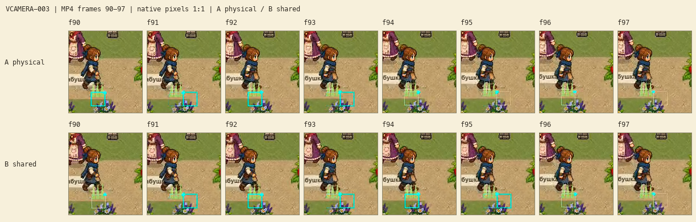

# Герой и окружение · единый кадр

**VCAMERA-003 выполнена: принят B — общая отображаемая поза.** Герой, его тень, камера и реакция окружения получают одну отображаемую позицию между физическими тактами. Игровая позиция по-прежнему отвечает за бой, столкновения и сохранение.

Все шесть MP4 воспроизведены до конца в браузере без ошибок. Прошли 544 профильных утверждения, 16 Python-сценариев, общий architecture, 45 254 игровых утверждения и 58 Wiki-тестов. Следующая карточка — [VCAMERA-006: приближение до 120%](#/development/tasks/visual--VCAMERA-006?queue=village-pilot).

При 60 физических тактах плавный кадр отстаёт от настоящей позиции не более чем на 16,7 мс. Это интерполяция двух известных состояний: она не прогнозирует движение сквозь стену. Пауза замораживает кадр, перенос или новая карта сбрасывает прежний след.

## 1152×648


## 1920×1080


## Retina 2× · 2304×1296


## На что смотреть

Первые 3 с — медленная диагональ через порог слежения. Затем явная смена подготовленной сцены и подход к левому краю. Жёлтый крест показывает стопу, голубой указатель — выбранную клетку. Небольшой зелёный QA-пучок получает ту же отображаемую ногу в uniform настоящего шейдера: вершины гнутся, корень остаётся в мировой точке. Это проверка синхронизации; художественную траву добавляет отдельный этап VFOLIAGE/VGROUND.

В обеих половинах камера уже дробная по VCAMERA-002. Стресс специально использует 30 физических тактов и 60 кадров видео в секунду, чтобы между тактами был виден дополнительный кадр. Штатные 60 физических тактов игры и масштаб 100% сохраняются. **Это не измерение FPS.**

| Измерение на одинаковом фрагменте | A · физический кадр | B · общая поза |
| --- | --- | --- |
| Повторы позиции камеры из 89 переходов | 45 | 0 |
| Максимальный шаг камеры, логические px | 0,4243 | 0,2122 |
| Размах шага камеры, логические px | 0,4243 | 0,000061 |

Числа совпали в трёх разрешениях. Физическая траектория, игровые часы, часы физической анимации и мировая позиция указателя полностью совпадают между A/B. В новом варианте положение стопы и uniform корня проверяются на каждом кадре.

## Доказательства



Лист показывает кадры 90–97, декодированные из тех же MP4, с исходными пикселями 1:1. Для оценки движения смотрите ролики выше; лист позволяет отдельно проверить стопу и корень. [Происхождение кадров](../../docs/reports/visual-overhaul/vcamera-003/video-review/source.json).

Профиль: 544 проверки фаз 30/60/120 Hz, стоп, камеры, корня, паузы, фокуса, переносов, F12 и сохранения. Настоящие автоматические callbacks движка записаны отдельно: 240 кадров, 119 разных отображаемых поз между одинаковыми физическими состояниями, без фазовых ошибок. Этот headless-контроль не подменяет нативное видео.

[Числа](../../docs/reports/visual-overhaul/vcamera-003/metrics.json) · [Автоматические callbacks](../../docs/reports/visual-overhaul/vcamera-003/live-callbacks.json) · [Происхождение нативной серии](../../docs/reports/visual-overhaul/vcamera-003/native/source.json).

```sh
tools/Godot.app/Contents/MacOS/Godot --headless --path . --script tools/presentation_pose_review.gd
python3 tools/presentation_pose.py verify
python3 tools/test_presentation_pose.py
```

[Карточка VCAMERA-003](#/development/tasks/visual--VCAMERA-003?queue=village-pilot) · [Принятая дробная камера](visual-camera-motion.md) · [Первый живописный участок](visual-pilot.md).
