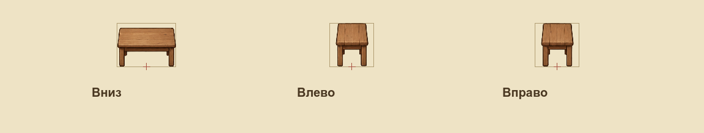

# Паспорт рисунка: ID, ракурсы и опора

У игрового рисунка теперь может быть устойчивый ID, который не зависит от имени PNG. Первый подключённый пример — дубовый стол `prop.rustic_table`. Здесь используется прежняя мебель: задача проверяет подготовку и подключение ресурсов, а новый живописный арт будет переноситься отдельными партиями.

## Что записано в паспорте

| Данные | Для чего нужны |
|---|---|
| ID предмета и ID текстур | Связать потребителей, сохраняя возможность переименовать файл |
| Область `source_rect` | Выбрать настоящий рисунок без чужого кадра или обрезанного края |
| Логический размер | Показать предмет в единицах мира, независимо от числа пикселей источника |
| Физическое основание | Рассчитать коллизию отдельно от высоты и ширины изображения |
| Нормализованная опора | Сохранить положение предмета на земле при другом размере PNG |
| Ракурсы | Для мебели — только вниз, влево и вправо; старый задний слот использует передний |
| Фильтр и качества | Хранить явное требование к показу и ссылки на действительно подготовленные варианты |
| Происхождение и SHA256 | Отличать старый проверенный ресурс от нового мастера и выявлять порчу файлов |

Таблица текстур хранит пути, пиксельные размеры и параметры импорта. Таблица ресурсов хранит смысл и геометрию. Имя файла не используется для определения ракурса, размера или качества.

## Три вида одного стола

Спереди стол вписывается в область 96×72 мировых единицы; сам рисунок занимает 96×64, а физическое основание — 72×48. Сбоку область вписывания 72×72, основание 48×72. Боковые рисунки уже: они сохраняют свои пропорции и не растягиваются до квадрата. Во всех трёх видах опора находится снизу по центру.

Игра, её проверка контента и каталог F12 читают одну геометрию. При размещении через F12 используются та же область рисунка, фактический размер и отдельное основание. Это помогает избежать ситуации, когда объект в палитре и в самой игре имеет разные размеры или коллизию.

## Разрешение и качество

Двойная плотность PNG не должна удваивать стол в мире. У вариантов качества меняются текстура и координаты выборки; мировая рамка, основание и опора остаются общими. Поддержка проверена на отдельных тестовых PNG. У настоящего стола сейчас только существующий `standard`: новый вариант высокого качества здесь не придуман.

Иконка 64 и превью 160 — разные роли интерфейса. Их массовый перенос запланирован отдельно. Новый паспорт не заменяет существующий каталог всех 386 иконок одним большим исходником.

VPIPELINE-003 подключила поле `sampling_family` и [адресную фильтрацию](visual-sampling.md). У стола выбран `painted_world` с `linear`, у старого интерфейса сохраняется `nearest`. Прежнее поле `filter` обязано совпадать с семейством. Фильтр применяется отдельной обёрткой текстуры, а не переключением всего игрового полотна.

## Что проверяется

Проверка до публикации сверяет PNG, контрольные суммы, размеры, непустую альфу, целую область рисунка, импортные профили, направления, качества и ссылки. Повторяющийся ID вызывает ошибку. Новый мастер остаётся вне игрового импорта и имеет отдельную контрольную сумму.

Тесты намеренно портят собственные копии, переименовывают PNG и выбирают другую плотность. Нативная проверка сравнивает комнату и три вида стола при одинаковой камере. Метаданные читаются один раз, дескрипторы кешируются, хеши и альфа не пересчитываются каждый кадр.

## Границы этапа

Сохранения и опубликованные уровни сохраняют прежний формат. Если старый уровень хранит путь PNG, ему ещё понадобится отдельная миграция при переименовании; стабильный ID каталога не переписывает сохранённые файлы автоматически.

Продолжение процесса публикации описано в [IDEA-001](IDEA-001.md). Предыдущий этап — [разделение исходников и игры](visual-pipeline.md). Текущий паспорт реализует часть этой идеи; автоматический перенос целой партии с откатом остаётся предложением.
