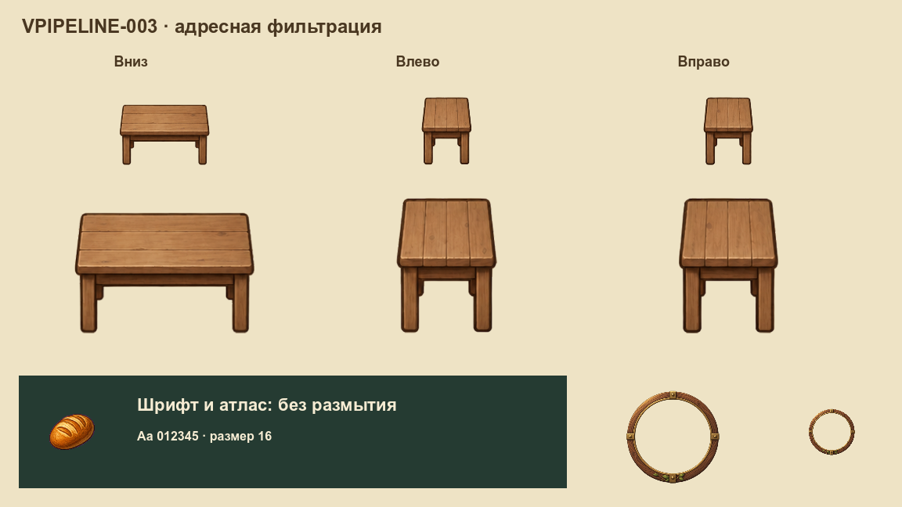

# Мягкие рисунки без размытия интерфейса

VPIPELINE-003 вводит адресную фильтрацию по семействам. Дубовый стол теперь использует `linear` в игре, палитре F12, призраке размещения и опубликованном уровне. Его три PNG, размеры, опоры и коллизии сохранены. Лунные часы также остаются на `linear`; неподготовленные атласы и шрифты сохраняют прежний режим. VPIPELINE-004 добавила [защищённые линейные миниатюры](padded-atlases.md).

Решение принято самостоятельно по действующим договорённостям проекта: для отдельного дубового стола мягкий край лучше подходит живописному направлению. Новая графика и массовая перерисовка этим этапом не добавляются.

## Сравнение в Godot

Одинаковые исходники, положение и масштаб 120%. Верхний ряд — мировой размер, нижний — инспектор с двукратным увеличением. Сравнение меняет фильтр стола и большой рамки часов; нижние шрифт, хлеб из атласа и маленькая рамка справа служат контролем.

**Nearest — прежняя выборка ближайшего пикселя.**

**Linear — принятая сглаженная выборка отдельного стола.**

В сохранённой матрице проверены также 75% и 100%, а каждый вариант повторён при двух общих фильтрах viewport. При изменении общего флага адресные рисунки и защищённый интерфейс остаются пиксельно одинаковыми. В настоящей комнате разница до/после ограничена прямоугольником стола 96×64; вне него кадр совпадает целиком.

## Семейства фильтрации

| Семейство | Режим | Где применяется |
|---|---|---|
| `legacy_world` | nearest | Прежние рисунки, которые ещё не перенесены в живописную партию |
| `legacy_ui` | nearest | Прежние иконки и атласы интерфейса |
| `painted_world` | linear | Проверенные отдельные рисунки мира; первый пример — дубовый стол |
| `painted_ui` | linear | Отдельные рисованные элементы интерфейса; лунные часы |
| `painted_atlas` | linear | Проверенные страницы миниатюр VPIPELINE-004 с отдельными полями и уровнями |

Общее полотно игры явно закреплено на `nearest`, поэтому старые шрифты и атласы не зависят от случайной смены настройки проекта. Для адресных рисунков используется [CanvasTexture](https://docs.godotengine.org/en/stable/classes/class_canvastexture.html): Godot позволяет задавать фильтр текстуры независимо от полотна. Обёртка создаётся один раз у владельца и использует тот же исходник. Пиксели не копируются при каждом кадре, отдельный узел для каждого стола не создаётся.

Политика хранится в `assets/game/visual_sampling.json`. Поле `sampling_family` в [паспорте рисунка](visual-resources.md) связывает ресурс с профилем; прежнее поле `filter` обязано с ним совпадать. Режим не вычисляется по названию PNG.

## Почему атласы защищены

У соседних кадров без запаса линейная выборка может захватить чужой цвет. Поэтому обычный `atlas` и попытка передать `AtlasTexture` как отдельный рисунок отклоняются. VPIPELINE-004 разрешила отдельный путь `padded_atlas` по проверенному паспорту. Он использует независимые страницы уменьшения; старым листам произвольный флаг готовности не помогает.

Повтор через противоположный край для адресного рисунка отключён. Фильтр не включает mipmaps, не меняет цветовые/data-профили и не сглаживает геометрию интерфейса. Эти параметры проверяются отдельно; обычная замена общего флага проекта не служит художественной миграцией.

## Проверки и продолжение

До публикации проверяются семейства, реальные PNG, альфа, области, импорты и независимость геометрии от фильтра. Отрицательные сценарии портят собственные копии файлов и контрольные пиксели нативного доказательства. У неизвестного семейства нет скрытого запасного режима.

Это проверка статичного рендера, а не измерение FPS. Память, скорость входа и длительные сессии остаются у OPT/VPERF. Полный перенос ресурсов, художественные партии и упаковка PCK имеют отдельные карточки.

Общий процесс — [от исходника до игры](visual-pipeline.md); предложение о публикации целого набора — [IDEA-001](IDEA-001.md).
