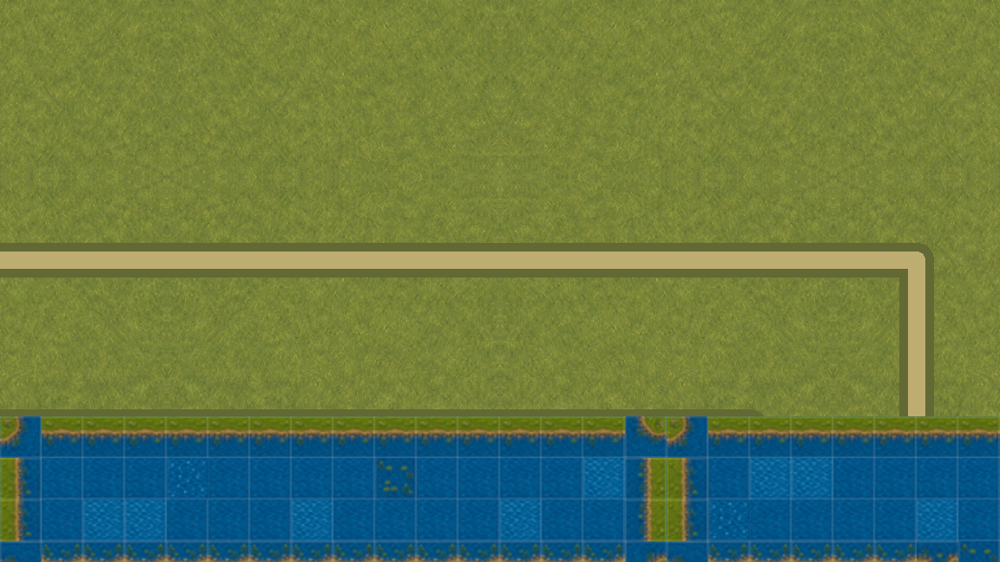
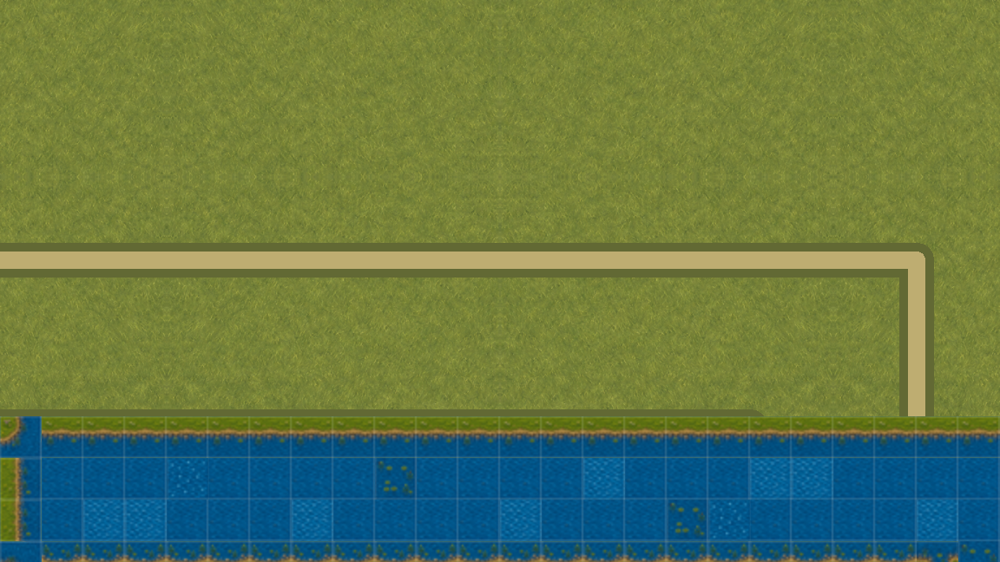

# Бесшовные водные чанки · соседний halo

VSHORE-004 устраняет ложный берег на границе двух групп воды. Каждая группа по-прежнему владеет только своими клетками, но `WaterTopology` классифицирует её кромку по общей карте: соседняя вода попадает в одноклеточный `halo`, а заполненные стороны публикуются отдельно.

## Что было не так

Если отдать модульному renderer только клетки одного чанка, край `x=15` считает клетку `x=16` сушей. Два владельца рисуют встречные береговые окончания — на прямой реке появляется вертикальная перемычка. Это особенно заметно при движении камеры.

Намеренно сломанный контроль воспроизводит такой случай на реальной первой `overworld`:

## Контракт владельца

Снимок `visual_chunk` содержит:

- только клетки своего чанка — соседняя клетка не рисуется второй раз;
- кардинальные и диагональные маски, рассчитанные по полной топологии;
- одноклеточный `halo` для проверки происхождения соседства;
- четыре счётчика заполненных сторон;
- только настоящие внешние береговые рёбра;
- локальную revision и кеш с инвалидированием непосредственных соседей.

На контрольном стыке левый снимок содержит 64 клетки и 4 соседние, правый — 48 и 8. По общей стороне найдено четыре симметричных заполненных контакта и 0 внутренних береговых рёбер. Все 240 повторных чтений использовали готовый кеш без пересборки.

## Одинаковая камера

`global` и `chunk-safe` сняты при одинаковом положении камеры. Их PNG совпадают побайтно; это проверяется не подписью в тексте, а реальными framebuffer-байтами. Рядом сохраняется отличающийся отрицательный контроль, поэтому равенство не может быть результатом пустого или замороженного кадра.

| Глобальная классификация                                                                    | Seam-safe чанки                                                                                  |
| ------------------------------------------------------------------------------------------- | ------------------------------------------------------------------------------------------------ |
|  |  |

В ролике 60 различных GPU-кадров, 1152×648, 30 fps, 2 секунды. Перед сохранением каждого кадра seam-safe режим сравнивался с глобальным эталоном. Это fixed-clock QA, **не замер FPS** и не запуск пользовательской игры.

## Проверки и следующий шаг

Профиль WATER прошёл 892 / 0 сценария: суша, мосты, навигация, рыбалка, декоративная вода, все маски и реальная граница `x=15/16`. Отдельные тесты проверяют дальнюю и граничную инвалидизацию кеша. Восемнадцать отрицательных сценариев портят временные копии доказательств и отклоняют подмену исходников, камер, PNG, H.264, метрик или логов.

VSHORE-004 не меняет физику и не объявляет воду художественно законченной. Спокойная анимация принадлежит VSHORE-005, направление течения — VSHORE-006. WATER-06 и VMAP-003 остаются отдельными воротами полной первой локации.

[Паспорт, исходные метрики и нативные доказательства](../../docs/reports/visual-overhaul/vshore-004/README.md).
