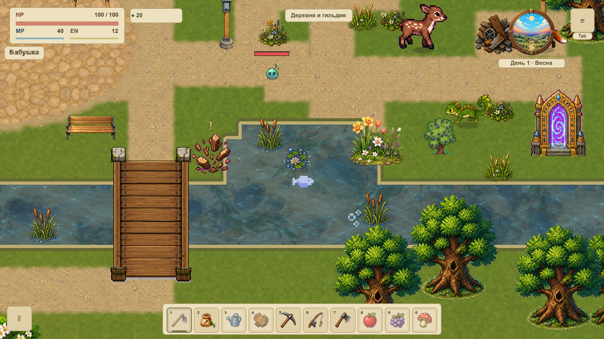

# Спокойная поверхность воды

VSHORE-005 добавляет мягкую рябь в первой деревне. На обычном качестве видны широкие волны и мелкий блик. На низком остаётся широкое колебание. Прозрачность в обоих режимах позволяет различать камни и растения под водой.

| Раньше | Обычный профиль | Низкий профиль |
| --- | --- | --- |
|  |  |  |

Ролик показывает первые две секунды у пруда, затем проход камеры через стык. Рисунок привязан к миру, а в меню и на паузе сохраняется последняя фаза. Настройка уменьшенного движения оставляет поверхность статичной.

Кадры на трёх одинаковых камерах проверены по пикселям. Изменение цвета осталось в пределах воды, суша и настил совпали с исходным кадром. Игровые проверки подтвердили прежнюю проходимость, рыбалку и декоративную воду. Направление течения входит в следующую задачу VSHORE-006. [Карточка задачи](#/development/tasks/visual--VSHORE-005) · [Манифест захвата](../../docs/reports/visual-overhaul/vshore-005/native/capture.json) · [Измерения по кадрам](../../docs/reports/visual-overhaul/vshore-005/native/metrics.json).
