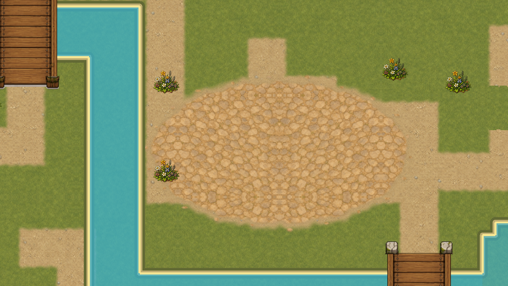
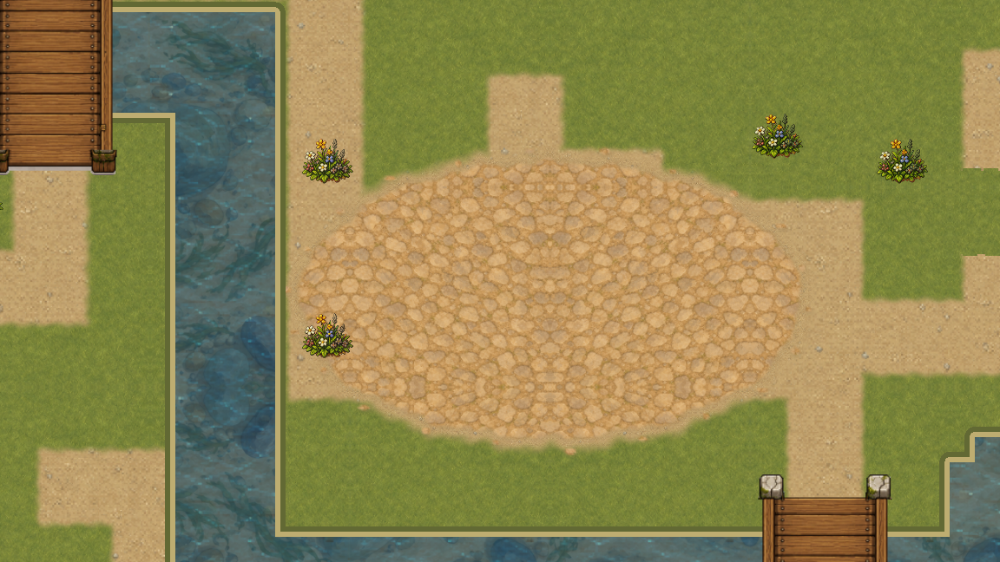
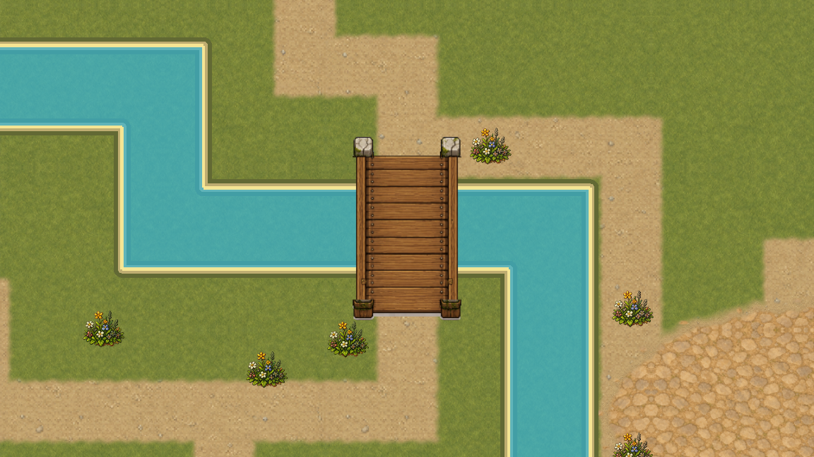
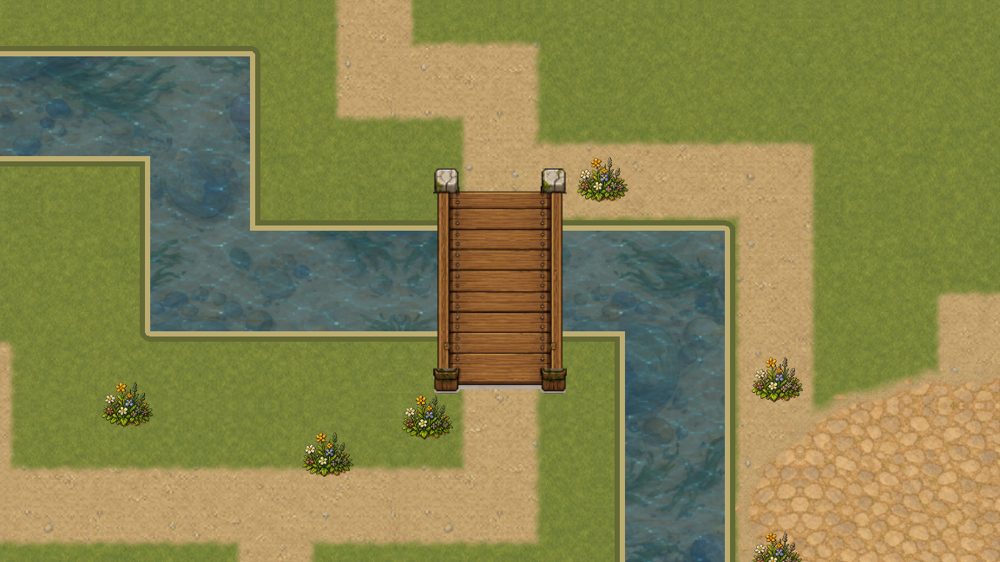

# Единая маска воды · WaterTopology

VSHORE-003 убирает расхождение между игровой водой и её изображением на первой `overworld`. Покрытие, глубина и внешний берег теперь собираются из одного канонического плана `WaterTopology`, а `WaterMapRegistry` передаёт этот же результат рендеру, навигации, рыбалке и визуальным эффектам.

## Один источник вместо двух контуров

Раньше рендер отдельно рисовал речной полигон и пруд, хотя игровые правила уже жили в клетках топологии. Из-за этого визуальная вода могла не совпасть с физикой, а пересечение тел давало двойное альфа-смешивание. Теперь 550 клеток сжимаются в два семантических региона и объединяются в один surface polygon. Внешняя кромка состоит из 20 кардинальных отрезков; граница между рекой и прудом берегом не считается.

Кадры сняты одной камерой. Диагностический режим намеренно выделяет body/depth разными оттенками; это инструмент проверки данных, а не будущий внешний вид воды.

## Вода под мостом

Мост не вырезает клетку из поверхности. Обе контрольные клетки остаются водой, но `on_bridge` разрешает движение по самостоятельному настилу, который рисуется верхним cover-слоем.

Так визуальная форма, столкновения и рыбалка не получают три разные версии одного места.

## Кеш и движение камеры

Visual snapshot привязан к revision топологии. Контрольный план строится один раз; 120 повторных чтений не вызвали ни одной дополнительной пересборки. Это проверка отсутствия очевидной работы на каждом чтении, **не замер FPS** и не бюджет всей карты.

Ролик содержит 72 различных GPU-кадра, 1152×648, 30 fps, 2,4 секунды. Это fixed-clock нативный QA-захват отдельного окна Godot 4.7.1; обычная игра и пользовательские сохранения не открывались.

## Проверки и границы

Профиль WATER содержит 871 успешный сценарий и 0 ошибок: суша, мосты, навигация, рыбалка, декоративная вода, глубина, банк, граница поля и неизвестная сухая локация. Строгий verifier связывает код, кадры, движение, H.264 и логи с implementation commit. Он отклоняет неверные размеры по заголовку до чтения RGB payload, затем последовательно и с ограниченной памятью проверяет реальные 72 кадра и три опорных состояния, а Git-историю читает только по полному hex commit. Двадцать отрицательных сценариев отдельно отклоняют повреждённый, чужой и замороженный ролик, опасные размеры, а также Git-опции с попыткой внешней записи.

VSHORE-003 принимает владельца маски, но не объявляет воду законченной. [VSHORE-004 добавляет соседний halo и бесшовный чанковый контракт](water-chunk-seams.md), спокойная анимация принадлежит VSHORE-005, направление течения — VSHORE-006. Полное закрытие WATER-06 и всей первой карты остаётся за их собственными критериями и VMAP-003.

[Паспорт и сырые доказательства](../../docs/reports/visual-overhaul/vshore-003/README.md).
