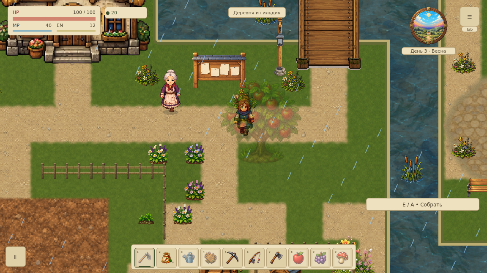

# Погода и игровая пауза

VWEATHER-001 в работе: реализация, полный игровой набор и новый нативный CI прошли. Независимое ревью и решение Team Lead ещё нужны. Дождь, снег и вспышка грозы теперь используют разрешённое время после движения героя; пауза сохраняет их положение.

[Draft PR №84](https://github.com/sergey-leonidovich-shevchenko/babushkina-ferma/pull/84): коммит `8689c111` прошёл 53 759 игровых проверок, обе серии перерисовки по 90 кадров, 127 архитектурных групп и 167 тестов Wiki. [Новый CI](https://github.com/sergey-leonidovich-shevchenko/babushkina-ferma/actions/runs/44948199161) сохранил 160 PNG в четырёх сериях; локальная проверка подтвердила чистый текущий кандидат. [Матрица кадров и SHA архива](../../docs/reports/visual-overhaul/vweather-001/native-ci-02/summary.json) · [Локальные проверки](../../docs/reports/visual-overhaul/vweather-001/native-ci-02/local-gates.json) · [Исходный CI-архив](https://github.com/sergey-leonidovich-shevchenko/babushkina-ferma/actions/runs/44948199161/artifacts/14724611930).

[Карточка VWEATHER-001](#/development/tasks/visual--VWEATHER-001) · [Исходный план в GitHub](https://github.com/sergey-leonidovich-shevchenko/babushkina-ferma/blob/e3935bc9a3a1ceda8ac810a9705b31909065cc92/docs/reports/visual-overhaul/vweather-001/PLAN.md) · [Порядок визуального кадра](post-motion-frame.md) · [Первый живописный участок](visual-pilot.md).

## Что проверяем

Во время ручной паузы осадки должны сохранять своё положение. Возвращение в игру добавляет только текущий разрешённый шаг, без скачка за время открытого меню. Та же граница действует для инвентаря, потери фокуса, редактора и режима уменьшения движения. В reduced motion гроза сохраняет дождь без вспышек.

Локальная фаза принадлежит одному игровому миру и его viewport. Вход в дом, возврат и загрузка завершают предыдущий визит; его частицы не должны оживать после перехода. Временное состояние не попадает в игровой слот и не меняет прогноз, календарь, дождевой полив или рост культур.

## Одна камера до и после

Принятая база, дождь, окно 1152×648:

Кандидат при той же камере и игровом снимке:

Это исходные кадры CI. Для проверки паузы тот же renderer отдельно рисует только погоду: соседняя анимация листвы не влияет на сравнение. В обоих окнах 1152×648 и 1280×720 дождь, снег и гроза исходной версии смещаются на паузе. В кандидате все шесть пар RGBA совпадают: фаза 0.04 → 0.04, после возобновления 0.06, после входа и возврата 0. Камера сохраняет 120% на улице и 100% в доме; два настоящих viewport имеют независимое время.

База: первый кадр на паузе.

База: после реального ожидания; капли сместились.

Кандидат: первый кадр на паузе, фаза 0.04.

Кандидат: после ожидания, та же фаза 0.04 и те же RGBA.

## Подтверждения и ограничения

Первый CI отклонил правильные 100% внутри дома из-за ошибочного требования reader. [Исходный отказ](../../docs/reports/visual-overhaul/vweather-001/failures/ci-01.json) и его архив сохранены; тот же настоящий набор воспроизводит old CLI exit1 → corrected CLI exit0. Все 14 регрессий на копиях реальных данных прошли. Первый CI остаётся failure; успешный второй CI не переписывает его историю.

Число модельных шагов часов не заменяет длительный аппаратный прогон. X11/llvmpipe не принимает Retina, GPU/FPS или VMAP-003. Новый рисунок дождя, маски крыш и снежный покров остаются за следующими VWEATHER-карточками. В изолированном слое после настоящего входа в дом всё ещё виден дождь; маска VWEATHER-003 остаётся открытой.
