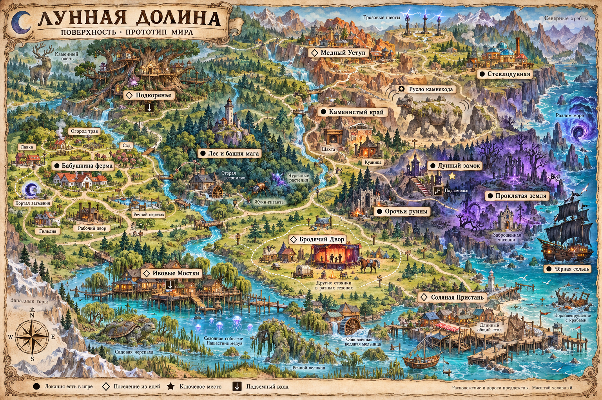
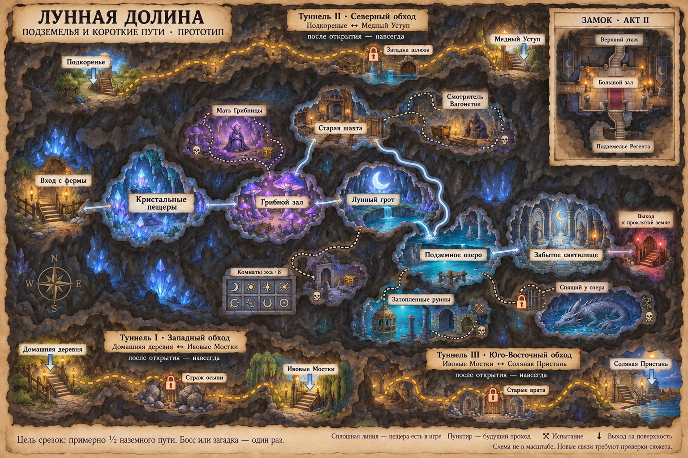
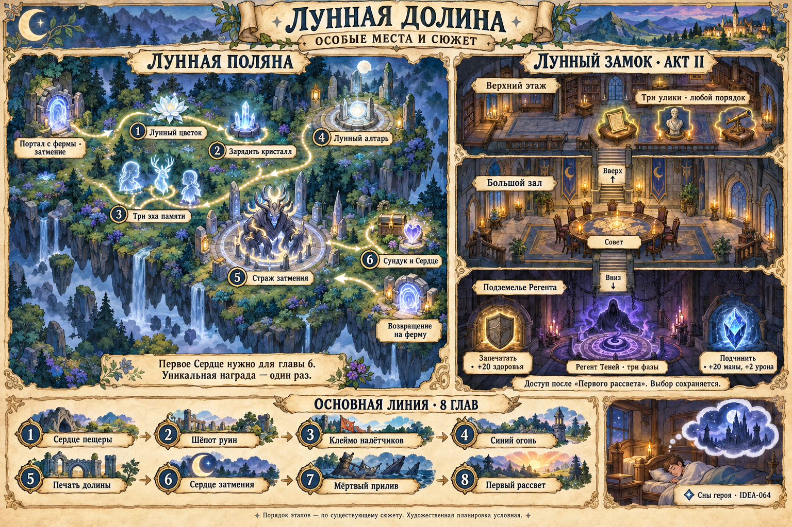

# Атлас Лунной долины

Три листа показывают **предлагаемый будущий мир**: поверхность, подземные пути и особые сюжетные места. Деревни, дороги и площадки собраны в одну долину с рекой, горным краем и выходом к морю. Это дизайн-прототип, не новая игровая карта и не приёмка живописной графики.

Заполненная точка означает, что соответствующая локация уже есть в коде. Ромб отмечает поселение или встречу из идей. **Даже у существующей локации положение, размер и внешний вид на этом атласе предложены заново.** Новые дороги не выданы за уже работающие переходы. Приоритет первой `overworld` до VMAP-003 сохраняется.

## Поверхность

Дом находится в западной спокойной части долины. От него расходятся лесное направление, дорога к каменистому краю и речная дорога. Север занят лесом, корнями и медными террасами; восток — руинами, замком и проклятой землёй. На юге река раскрывается в бухту, где есть место лодке, пристани и маленькому острову. Большой морской разлом и «Чёрная сельдь» остаются на восточном краю основной истории.

### Шесть поселений и их занятия

| Место | Основа и важные отметки | Статус источника |
|---|---|---|
| **Ферма и домашняя деревня** | Дом, шесть районов одной деревни, гильдия, лавка, сад травницы, переправа и ремесленный двор. Здесь размещаются будущие гостевой двор, артель, родословные животных, семейная жизнь и домашняя выставка | Основа есть в игре; новые занятия — отдельные идеи |
| **Ивовые Мостки** | Свайные дома, фонари, лодочник, Марена, светлячки и черепаха-сад. Летом проходят фонарницы; здесь начинается речной торговый путь | IDEA-068, 103, 109, 113, 117, 143, 145, 167 |
| **Медный Уступ** | Террасы, кузнечное ремесло, подъёмники, Радан, ярмарка походных чертежей. Отсюда заметен камнеход и начинается северная сигнальная тропа | IDEA-069, 101, 108, 112, 145, 165, 168 |
| **Подкоренье** | Дома у основания древнего дерева, живые арки, садовые формы, семена и каменный олень. Верхушки дерева не становятся обязательной многоэтажной картой | IDEA-070, 102, 107, 160, 167 |
| **Соляная Пристань** | Общий стол, рыба, соль, старый берег и лодочные вылазки. Рядом речной исполин, корабельный остов и необязательные находки | IDEA-071, 104, 110, 117, 167 |
| **Бродячий Двор** | Одно передвижное поселение со знакомыми людьми, театром теней и дорожной ярмаркой. Пустые стоянки — другие адреса той же общины | IDEA-072, 105, 111, 115 |

Первые пять новых деревенских профилей остаются предложениями в своих исходных карточках; рисунок не переводит их в реализованные или одобренные. Бродячий Двор не дублирует [собственный торговый караван](IDEA-166.md): это чужая знакомая община, а караван перевозит груз игрока.

### Что искать на дорогах

**Лес:** башня мага, Страж чащи и механизм первой главы, спасения животных, лесопилка Смоляного Собирателя, Панцирный Дед, Корневой Кнут и история Моховика. У верхних троп — отдельная поляна Беззвёздного Оленя, не сюжетная Лунная поляна.

**Горный край:** существующая кузница и добыча, будущие зачарования, Медный Уступ, литейный зал Медного Горна, сигнальный пост и Пастух Грозы. Камнеход идёт по своему руслу; его осыпь — мирное событие, не награда за убийство великана.

**Руины и проклятая земля:** тюрьма спутников, ключ и орочий клинок основной линии, Лунный замок и часовня. Здесь подходят отдельные ловушки, расследования и археология; обязательная дорога не превращается в цепочку всех шестидесяти ловушек.

**Река и берег:** восстановленная мельница и отдельная арена Мельника Без Ветра, переправы, купальня, лодочные причалы, общий стол, Король Пустых Сетей у остова и затопленные находки. Водные расширения не перекрывают обычные дороги.

Кулинария, окрашивание тканей, витражи, музыка, свидания, трофеи, личный ослик, торговля и работники имеют точки применения в этих местах. Каждому переносному предмету или общему правилу инвентаря отдельный географический значок не нужен. Их полная привязка сохранена в [матрице покрытия](../../docs/reports/world-atlas-2026-10/coverage.csv).

## Подземелья и короткие пути

В центре сохранён настоящий граф шести пещерных комнат: входные Кристальные пещеры → Грибной зал → Лунный грот → Подземное озеро → Забытое святилище. Старая шахта образует вторую ветвь **Грибной зал ↔ шахта ↔ озеро**. Прямого перехода шахта ↔ Лунный грот здесь нет. Вход с фермы, условие выхода из святилища и сюжетная реликвия остаются своими действующими механизмами.

Мать Грибницы, Смотритель Вагонеток, погружение, Спящий под озером и восемь комнат эха — будущие боковые занятия. Схема предлагает места, но не объявляет их частью уже реализованной пещеры. Звонарь Последней Минуты, Кузнец Затмения и нижняя служба печати также требуют отдельных необязательных ответвлений; ни одно не становится скрытым условием основного финала.

| Срезка | Предложенные концы | Первое открытие |
|---|---|---|
| **I — западный обход** | Домашняя деревня ↔ Ивовые Мостки | Местный Страж осыпи; затем постоянная решётка |
| **II — северный обход** | Подкоренье ↔ Медный Уступ | Загадка старого шлюза |
| **III — юго-восточный обход** | Ивовые Мостки ↔ Соляная Пристань | Отдельное авторское испытание старых врат |

Это три самостоятельных пешеходных коридора, не единое метро под всеми локациями. Они не соединены с комнатой Регента или сюжетным святилищем. После открытия работают в обе стороны, не требуют повторных боссов, платежей и зачисток. Цель — **45–55% времени наземного пути вместе с дверями, спуском и подъёмом**; на этом рисунке время ещё не измерено. Тележка в тесные ходы не проходит. Полные правила и приёмка — в [IDEA-169](IDEA-169.md).

Факелы, поясной фонарь, дорожные метки и инструменты CAMP учитываются как снаряжение путешествия. Часть их плана находится в отдельной ветке; наличие рисунка не добавляет рецепты в игру. Для существующих и будущих коридоров сохраняются доступный выход, свет в безопасной входной зоне и правила автоматического подбора PACK.

## Особые места и основной сюжет

**Лунная поляна** — особая область через портал затмения у фермы. Её нельзя принять за Лунный грот внутри обычной пещеры. Цветок, кристалл, три эха памяти, алтарь и Страж идут в существующем порядке; первое Сердце требуется для шестой главы. Это не восемь будущих головоломок ECHO с двойником героя.

**Замок** расположен у руин. Совет в большом зале становится доступен после «Первого рассвета», три улики находятся наверху, ритуал и Регент — внизу. После трёх фаз боя выбирается один постоянный итог: +20 максимального здоровья либо +20 маны и +2 урона. Два итога одновременно не выдаются. Сны героя отмечены отдельно как IDEA-064; это будущее занятие, не существующий обязательный переход.

Восемь глав основного сюжета сохраняют порядок: Сердце пещеры → Шёпот руин → Клеймо налётчиков → Синий огонь → Печать долины → Сердце затмения → Мёртвый прилив → Первый рассвет. Новые деревни, разведение, гостиница, великаны и экспедиционная история помогают исследовать мир, но не заменяют его ключи и условия.

## Как читать этот прототип

Расположение северных хребтов, реки, береговой линии и новых площадок выбрано для первого общего взгляда. Размер игрового экрана, точные километры и длительность путешествия пока не заданы. Указанные поселения могут занимать несколько игровых карт; соседство на рисунке не регистрирует новый выход.

Для следующей проработки нужны одна реальная пара деревень и измеренный обычный маршрут, затем одна принятая срезка. Разделение на поверхность, подземелья и особые области сохраняется. Игровое внедрение ждёт завершения первой живописной `overworld`; текущая работа завершает только атлас и его проверяемую привязку к планам.

[Что учтено и откуда взяты сведения](world-atlas-coverage.md) · [Машинный реестр мест и связей](../../docs/reports/world-atlas-2026-10/atlas-data.json) · [Подготовка ATLAS-00](#/development/tasks/atlas--ATLAS-00).

[Региональный бестиарий IDEA-073](IDEA-073.md) развивает этот атлас: враги по областям, гномья артель, тёмные эльфы, мирные зоны и связи с боссами.
