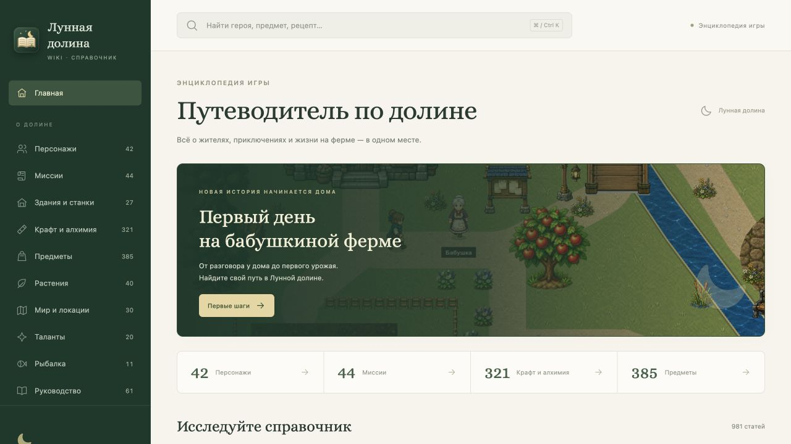
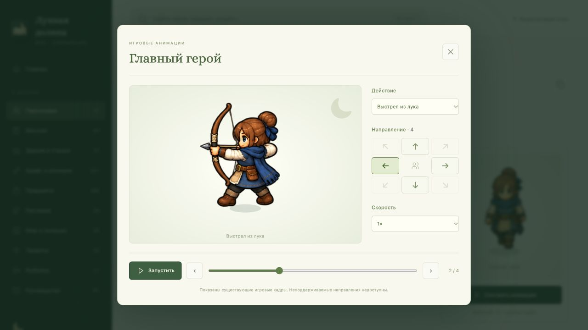

# Проверка Wiki — 13 октября 2026

Проверена отдельная Vue 3 / TypeScript wiki для игры 0.0.142 перед публикацией. Каталог выгружен из игры: **981 статья**, включая 42 персонажа, 44 миссии, 27 зданий и станков, 321 рецепт, 385 предметов, 40 растений, 30 локаций, 20 талантов, 11 рыб и 61 главу руководств. Используются 749 PNG, полученных из действующих игровых ресурсов.

## Автоматические проверки

`pnpm check` завершился успешно: экспорт Godot без `ERROR:`, проверка каталога и ссылок, TypeScript, production-сборка и 11 тестов Node. Проверяются все PNG и границы кадров, доступность анимаций всех персонажей, полнота реестров, русский поиск и партии рецептов, localhost HTTP, занятые порты, восстановление сборки и приложение macOS. `tools/check_architecture.sh` также прошёл; собственные ссылки wiki проверяются, зависимости и выходные папки исключены из сканирования документации.

## Браузер и приложение

- Главная показывает реальные размеры каталогов и переходы к каждому разделу.
- Поиск «Агафья» находит жителя первым; его статья содержит задания, подарки и связанные локации. Проверены направления и ходьба.
- У героя проверены выстрел из лука влево, смена действия, пауза и кадры. Неподдерживаемые диагонали отключены.
- Четыре партии стекла показывают 12 песка и 8 стекла. Ссылки ведут к предметам и горну; уровни горна показывают собственные стоимость и материалы.
- В консоли проверяемой вкладки нет ошибок.
- Исполняемый файл `Лунная долина Wiki.app` действительно пересобрал сайт, использовал работающий сервер проекта и открыл браузер. Диагностический запуск также проверяет пути с пробелами и кириллицей. ICNS прочитан штатной утилитой macOS.
- Проверка выполнена в настольном браузере шириной 1280. Встроенный браузер не применил запрос на мобильную ширину; мобильная ручная проверка остаётся отдельным пунктом [QA_CHECKLIST.md](../../QA_CHECKLIST.md).

## Снимки интерфейса

Снимки сделаны в браузере с работающим сайтом, до автоматического увеличения версии коммитом.

