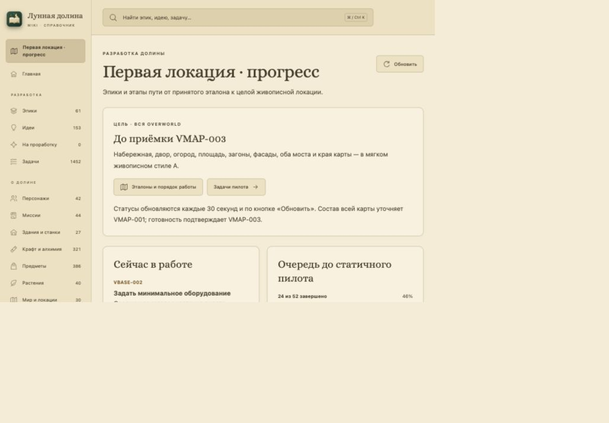
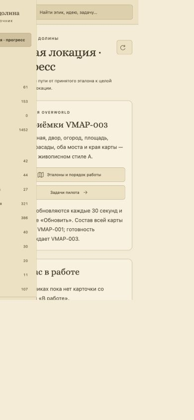

# WIKI-002 · Первая локация — прогресс

19 октября 2026. Первый пункт основного меню открывает `#/development/first-location` перед «Главная». Пять групп содержат ссылки на 22 существующих эпика VIS/WATER; исходные владельцы, статусы, группы и идеи сохранены.

Обзор показывает текущие карточки в работе, точный счётчик очереди статичного пилота, следующие готовые карточки и шесть этапов от VRELEASE-002 до VMAP-003. Статусы обновляются кнопкой и каждые 30 секунд. VMAP ограничен 001…003, VRELEASE — 001…005. Счётчики остальных эпиков подписаны как полный объём; для VBUILD/VACTOR/VPLANT явно указано, что состав первой карты уточняет VMAP-001. Прогресс пилота и полного каталога не выдаётся за процент готовности всей карты.

## Проверка

- Пять новых сценариев проверяют сохранность каталога, исключение других карт, живые изменения статусов, приёмку только по настоящей visual--VMAP-003, явное отсутствие данных и подписи полного каталога.
- `pnpm --dir wiki check`: экспорт, TypeScript, production-сборка и 56 Node-тестов пройдены.
- Браузер: прямой адрес, первый пункт меню, переход клавиатурой, исходный VGROUND, VMAP-003 и очередь пилота; пять групп / 22 эпика / шесть этапов. Изменение статуса только во временном каталоге автоматически обновило счётчик 24→25 из 52 без перезагрузки.
- Широкая проверка — 1028 CSS px, мобильная — 390 CSS px. Ширина документа совпала с viewport, горизонтального переполнения нет; мобильное меню закрывается и при выборе уже открытого обзора.
- Первому изолированному worktree потребовался старый игнорируемый `.import` стенда VPIPELINE-009: восстановлен из существующего checkout только после совпадения SHA-256 с сохранённым fixture. Отчёты, runtime и проверки этим не менялись. После восстановления профильная проверка миграции прошла.
- Общие архитектурные и игровые проверки выполняются обязательным pre-commit; готовый коммит вливается в локальную main по пакетному порядку проекта.

## Кадры

Кадры сняты в отдельном сервере с временным каталогом; игровые слоты и рабочие редакционные решения не менялись.

