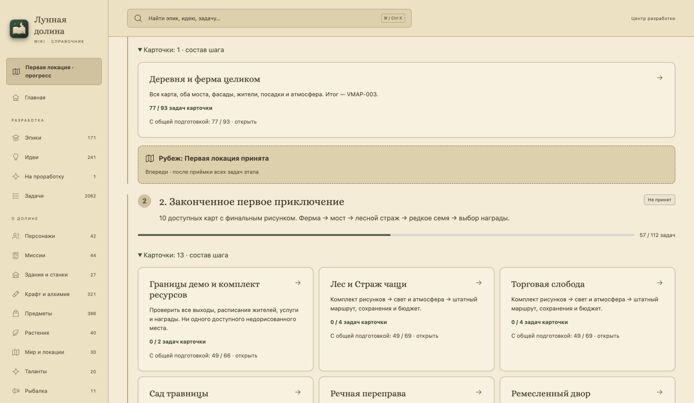
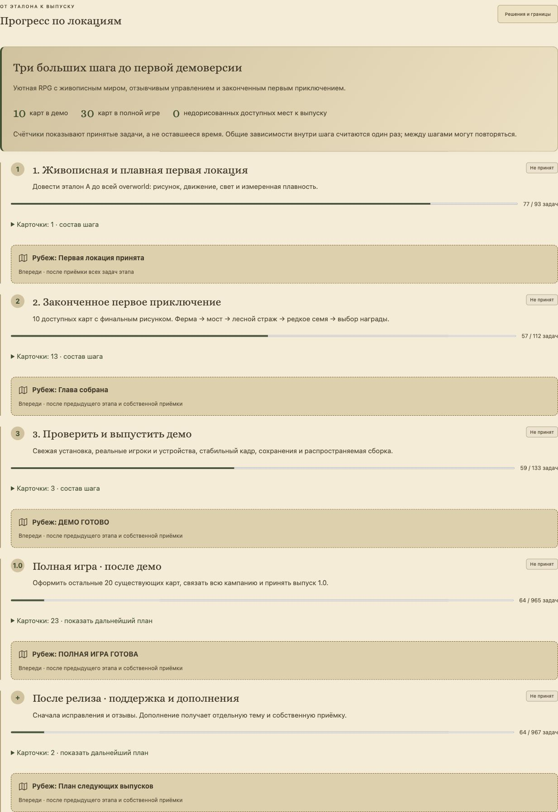
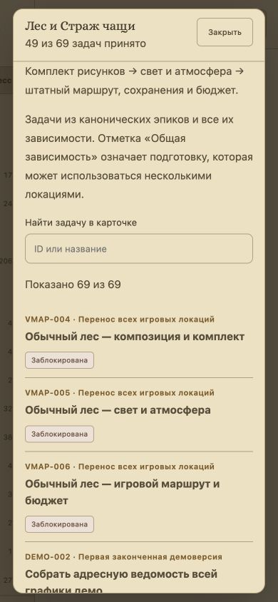

# WIKI-005 · От первой локации до выпуска

16 ноября 2026. База реализации: `5f4306f4cfc9471cd8076b0d918b7a40fe717ee2`.
Ветка: `codex/wiki-005-release-roadmap`. До независимой приёмки и merge карточка остаётся `in_progress`.

## Результат

В существующем обзоре Wiki появились три последовательных шага демо, отдельный полный выпуск и поддержка. Все 30 существующих карт имеют собственные карточки; 10 входят в демо, остальные 20 — в 1.0. В карточках находятся канонические задачи разных эпиков и полные зависимости. Прямые задачи и общая подготовка подписаны отдельно. Счётчик шага устраняет повторы; он не оценивает оставшееся время разработки.

Пропущенный ID, неоднозначная зависимость, цикл или неисправный список пилота запрещают отметку готовности. Следующий рубеж требует принятого предыдущего. Статусы читаются из общего каталога и обновляются штатным механизмом Wiki. История выполненного и сравнения «До и после» сохранены.

Предварительный просмотр Tech Lead выявил обычный счётчик общей подготовки при неполном списке и непереданную карточке ошибку пилота. Оба случая исправлены до публикации: неполная карточка скрывает дробь, ошибка очереди видна и в карточке, и в её окне; регрессия проверяет передачу ошибки.

Новый источник `release` содержит 13 будущих задач в DEMO, RELEASE и LIVE. `DEMO-002` принимает ведомость ресурсов; `DEMO-007` — фактически готовую графику после выполнения адресных задач. Это позволяет выполнять производство последовательно. `DEMO-001` отдельно проверяет возвращение домой после награды: текущий `early_return_location` ограничен незавершённой главой. Runtime в WIKI-005 не исправлялся.

По полномочию владельца одобрена только IDEA-192: ограниченные мокрые следы после DEMO-006. Прежние ID, оценки и история сохранены; три игровые задачи остаются невыполненными. Остальные решения не изменены. Плейтестовые 45–90 минут, 4/5 прохождений и 3/5 желающих продолжить — гипотезы будущей проверки.

## Проверки реализации

- `pnpm --dir wiki check`: экспорт, TypeScript, production-сборка и **164 теста, 0 ошибок**. Пять новых сценариев проверяют реальный каталог, все 30 карт, изменение статусов, отсутствующие/циклические/неоднозначные зависимости, разделяемые задачи и сохранность решений.
- Prettier для изменённых Vue/TS/CSS/теста и `git diff --check`: пройдены.
- `python3 tools/run.py quality.check`: **0 failed steps**, 276,590 с. Использованы закреплённый Python 3.11 с зависимостями quality и официальный Godot 4.7.1.
- Общие architecture и Game/normal/F10 выполняются штатным полным pre-commit при создании коммита. Начатый отдельно архитектурный прогон остановлен перед hook, чтобы не выполнять два конкурирующих набора; он не считается успешной проверкой. Результаты завершённого hook и точный проверенный head публикуются в PR и карточке WIKI-005.
- Первый полный hook остановился на `planning.test_task_batch`: Git из bundled fallback искал отсутствующие `//share/git-core/templates`, поэтому bare fixture не получил каталог hooks. Тот же профиль со штатным `/usr/bin/git` прошёл **16/0**; исходники проверки не менялись. Для повторного полного hook штатный Git стоит в PATH перед fallback.

## Браузер

Проверен собственный сервер worktree на `127.0.0.1:4180`, production-сборка, Chrome. Рабочий сервер Developer Agent на 4174 не заменялся.

- На широком экране видны три шага, будущие рубежи демо/1.0 и последующий план. Непринятый рубеж прямо подписан «Впереди».
- «Лес и Страж чащи» открывает 69 задач, включая VMAP-004…006 и DEMO-002. Поиск `VMAP-006` оставляет одну строку; переход открывает каноническую задачу.
- Escape и «Закрыть» закрывают диалог и возвращают фокус исходной кнопке. Диалог прокручивается, заголовок и закрытие доступны.
- При ширине 390 CSS px ширина документа равна 390: горизонтального переполнения нет. Карточки и строки задач переходят в одну колонку.
- Раскрыты полный выпуск и поддержка; проверены карточка каменистой области, патчи и предпроект DLC. Ссылка «Решения и границы» открывает статью с десятью картами, эталоном A и порядком работы команды.
- Проверки интерфейса не записывали решения в рабочий каталог.
- Замечания Tech Lead повторены в отдельном memory-only каталоге: удалена VMAP-033 и добавлена зависимость пилота вне очереди. У обеих карточек скрыты дроби прогресса; диалог первой карты показывает причину неполноты и доступные задачи. Рабочие данные не изменялись.

## Передача команде

Team Lead, Tech Lead и Developer Agent уведомлены в существующих чатах по прямому поручению владельца. Team Lead подтвердил: текущая VSHORE-005 / PR №54 → VSHORE-006 → живой пилот и бюджет → VMAP-001…003. Затем DEMO-001, VRELEASE-006, ведомость DEMO-002 и адресное производство демо. Старые принятые REFACTOR-03/07/06 не запускаются повторно. WIKI-005 оформляется отдельным PR с независимым ревью точного head.

Это проверка роадмапа и постановки. Она не подтверждает готовность графики десяти карт, FPS, реальных устройств, внешнего плейтеста или распространяемой игры.

## Кадры

Счётчики на кадрах относятся к базе 0.0.433 и меняются вместе с каталогом.

