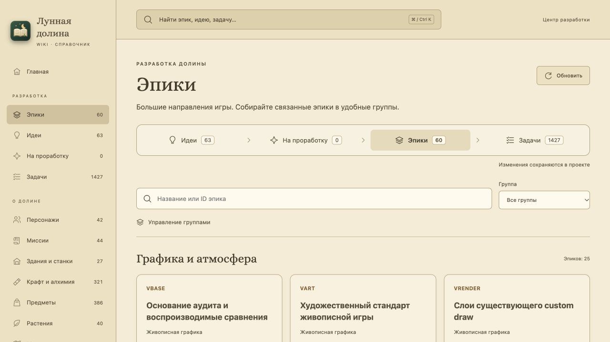
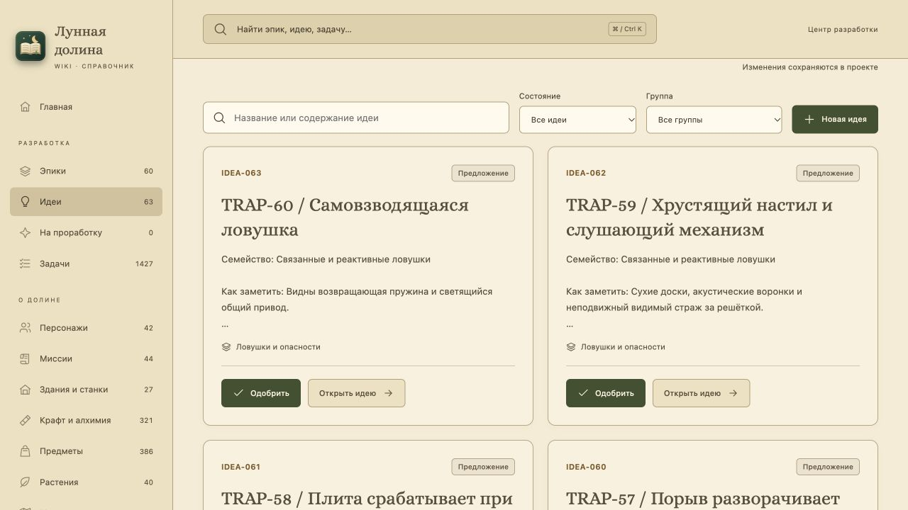
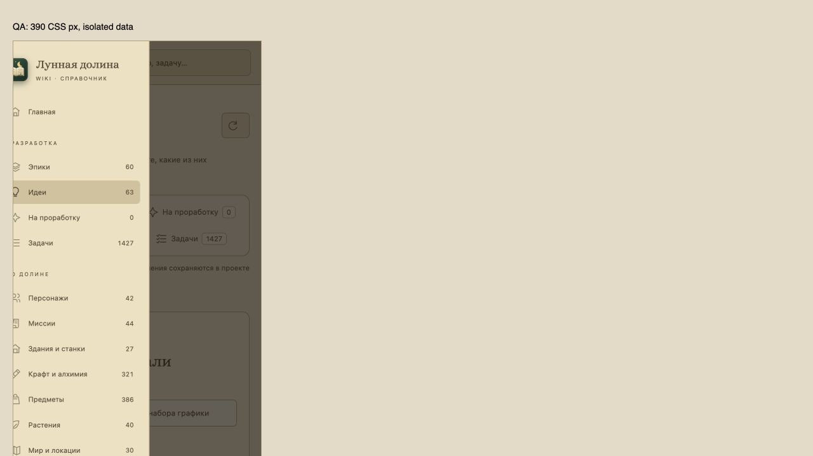

# WIKI-001 — центр разработки

В Wiki появился отдельный раздел разработки: эпики по редактируемым группам, идеи, очередь проработки и общие карточки задач. На момент приёмки импортированы **10 планов, 60 эпиков, 1427 задач и 63 идеи**. Новые стандартные планы обнаруживаются при обновлении. Реестр идей, дополненный параллельной постановкой, сохранён без тестовых записей.

## Проверки

- `pnpm --dir wiki check`: экспорт Godot, проверка всех источников, TypeScript, сборка, **38 Node-тестов**, без ошибок.
- Архитектурный gate и полный игровой набор обязательны перед коммитом; последний игровой прогон — **42398 passed, 0 failed**. Изоляция Git fixtures дополнительно исправлена отдельным коммитом: унаследованные `GIT_*` не затрагивают родительский репозиторий.
- Рабочая Wiki в браузере: меню, общий поиск `WATER-04`, переход в карточку, две настоящие зависимости, индивидуальная приёмка, группы эпиков и 63 идеи с кнопками одобрения.
- Отдельный fixture-сервер с временным state: создание QA-идеи, одобрение и появление в очереди, обновление страницы, переход в проработку, сохранение изменённых заметок и связь с WIKI. Идея стала «Задачи созданы», очередь уменьшилась, статус самой WIKI-карточки не изменился из-за этого действия.
- На том же fixture проверены создание/переименование группы и перенос WIKI с сохранением после обновления.
- Две реальные вкладки fixture: вторая запись получила 409. После «Обновить данные» местный заголовок сохранился, а независимые новые заметки первой вкладки подтянулись в форму.
- Режим статического просмотра проверен на прежнем сервере: явный баннер, отключённые операции записи. Основная рабочая Wiki запускает собственный API через launcher; занятый чужой порт не останавливается.
- Адаптивная вёрстка: iframe с настоящей шириной **390 CSS px**, измерены `innerWidth=390` и `scrollWidth=390`, форма не создаёт горизонтальной прокрутки, мобильное меню раскрывается. Host браузера 1280×720; это проверка CSS, а не физического телефона. Переопределение viewport инструмента не изменило host, поэтому оно не использовалось как доказательство ширины.

Все браузерные записи выполнялись только в отдельных временных файлах через `node wiki/scripts/planning-review.mjs --fixture`; для iframe использовался `--frame` с SAMEORIGIN только на тестовом сервере. Основной сервер сохраняет `X-Frame-Options: DENY`. Открытие Wiki и загрузка справочников не меняют игровые слоты, не запускают игровые события и не выполняют Git-команды.

## Скриншоты

[Процесс и API](../../../docs/WIKI_DEVELOPMENT.md) · [Карточка WIKI-001](../../../docs/backlog/wiki-workspace-2026-10/README.md)
